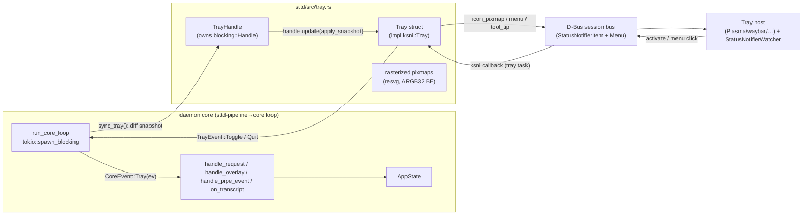

# Plan: StatusNotifierItem tray icon for `sttd`

**Status:** draft — sharpened via grilling session (2026-08-01)
**Owner:** stt-wayland
**Goal:** the `sttd` daemon registers a dynamic tray icon reflecting its state (idle / recording / paused / error), with tooltip, click-to-toggle, and a menu — so users can control capture without a terminal.

---

## 1. Protocol decision

The daemon will implement **StatusNotifierItem (SNI) over D-Bus** — the de facto Linux tray protocol (`org.kde.StatusNotifierItem` + registration against the `org.kde.StatusNotifierWatcher`). Rationale:

- Every mainstream tray host implements it: KDE Plasma (present on this machine), GNOME (AppIndicator extension), waybar, swaybar, nwg-bar.
- There is **no merged Wayland-native status-icon protocol** in wayland-protocols; layer-shell (already used for the overlay) is for surfaces, not tray items.
- Pure-Rust client exists (`ksni`), so **no new system libraries** enter the runtime closure — the earlier `autoPatchelfHook` work stays untouched.

### Chosen stack (source-verified against ksni 0.3.6)

| Crate | Version | Notes |
|---|---|---|
| `ksni` | 0.3.6 | SNI server. **Pure-Rust zbus 5** — no `libdbus.so`. Features: exactly one of `tokio`/`async-io` (default `tokio`) + optional `blocking`. |
| `resvg` (usvg + tiny-skia) | latest | Rasterizes our SVG icons → RGBA pixmaps at runtime. Pure Rust. |
| `tiny-skia` | via resvg | Format conversion to ARGB32 big-endian. |

**Feature choice:** `ksni = { version = "0.3", features = ["blocking"] }` (default `tokio` + `blocking`). The daemon's core loop runs inside `tokio::task::spawn_blocking` (main.rs:256), so we need the **sync** `ksni::blocking` API (`spawn()`, `Handle::update()`), which runs the service on its own `std::thread` via a static current-thread runtime. This also keeps the tray fully independent of daemon thread teardown order. (zbus#526 caveat — another crate running zbus on its own executor — does not apply: we are the only zbus user.)

---

## 2. Architecture



### Threads

- **Tray service thread** — owned by ksni (`blocking` feature); serves D-Bus objects, hosts the SNI menu, runs menu/activate callbacks.
- **Core loop thread** — pushes state snapshots into the tray via `Handle::update` (sync), and receives `TrayEvent`s over an `mpsc` channel bridged into `core_tx` (same pattern as the existing `sttd-overlay-fwd` / `sttd-pipe-fwd` bridge threads, main.rs:191-222).
- No new long-lived thread of our own.

### State push model

`run_core_loop` already polls `core_rx` every 10 ms and drains STT results at the top of each iteration — which is where *every* state mutation happens (IPC, overlay callbacks, pipeline events, transcript injection errors). We add **`sync_tray()` at the end of each loop iteration**, diffing a small snapshot `(state, mode, last_error, model_name)` against the last one sent; push only on change. This covers all mutation sites with one hook and zero 10 ms spam.

### Tray → daemon actions

Menu `activate` callbacks and `Tray::activate()` run on the ksni tray task and **must be non-blocking** (they serialize the tray loop). They only send on a channel:

```rust
pub enum TrayEvent { Toggle, Quit }
```

Bridged into a new `CoreEvent::Tray(TrayEvent)` arm.

---

## 3. File-by-file changes

### 3.1 `Cargo.toml` (workspace)

```toml
# Tray (SNI over D-Bus)
ksni = { version = "0.3", features = ["blocking"] }
resvg = "0.45"
```

### 3.2 `sttd/Cargo.toml`

```toml
[features]
default = ["audio", "stt-engine", "overlay", "inject", "tray"]
tray = ["dep:ksni", "dep:resvg"]

[dependencies]
ksni = { workspace = true, optional = true }
resvg = { workspace = true, optional = true }
```

### 3.3 `sttd/src/config.rs` — `TrayConfig`

```rust
#[derive(Debug, Clone, Serialize, Deserialize)]
#[serde(default)]
pub struct TrayConfig {
    /// Register a StatusNotifierItem tray icon (needs a session D-Bus bus).
    pub enabled: bool,
}
// Default: enabled = true
```

- Added to `Config`, wired into `Config::normalize()` (no legacy aliases needed).
- Doc-comment: missing session bus / watcher → silent no-op (no error state).

### 3.4 `assets/tray/*.svg` (new, committed)

Four simple 24×24 SVGs, authored once and kept in repo (per decision):

| File | Visual |
|---|---|
| `idle.svg` | muted microphone, neutral grey |
| `recording.svg` | microphone + red recording dot |
| `paused.svg` | pause bars (⏸) |
| `error.svg` | microphone with alert badge / red circle |

Embedded via `include_bytes!("../../assets/tray/idle.svg")` — no runtime path resolution, works from any cwd.

### 3.5 `sttd/src/tray.rs` (new module)

```rust
pub struct TrayHandle {           // mirrors OverlayHandle pattern
    handle: Mutex<Option<ksni::blocking::Handle<Tray>>>,
    ev_tx: Sender<TrayEvent>,
}
pub enum TrayEvent { Toggle, Quit }
pub struct TraySnapshot { state: DaemonState, mode: Mode, error: Option<String>, model: String }
```

- `TrayHandle::new(cfg: &TrayConfig) -> TrayHandle` — when `enabled == false` **or** `cfg(feature = "tray")` off, returns a no-op stub (`handle: None`). Mirrors `OverlayHandle`'s feature-gated stub exactly.
- `fn sync(&self, snap: TraySnapshot)` — no-op when stub; else `handle.update(|t| t.apply(snap))`.
- `Tray` implements `ksni::Tray`:

```rust
fn id(&self) -> String            { "sttd".into() }        // required, stable, unique
fn icon_pixmap(&self) -> Vec<Icon>  // current state's pixmaps, sizes 16 + 24
fn icon_name(&self) -> String       // theme fallback (see §5)
fn title(&self) -> String           // "sttd"
fn tool_tip(&self) -> ToolTip       // title "sttd", description state·model or error
fn status(&self) -> Status          // NeedsAttention when error, else Active
fn activate(&mut self, _x, _y)      // → ev_tx.send(Toggle)
fn menu(&self) -> Vec<MenuItem<Self>>  // §6
fn watcher_offline(&self, _reason) -> bool { true }  // stay alive; auto re-register
```

- **Icon pipeline** (`icon_pixmap`): on first use, rasterize the current state's SVG with `resvg` at 16 and 24 px → RGBA → convert each pixel to **ARGB32 big-endian** (`rgba.rotate_right(1)` per byte, per ksni docs) → `Icon { width, height, data }`. Cache all four states × two sizes once at startup (they never change); `icon_pixmap()` just selects by state.
- **ksni registration:** `tray.assume_sni_available(true).spawn()` (sync variant) — per user decision, **no host → silent no-op**: spawn returns `Ok` with the service idle, `watcher_offline` fires, and ksni **auto re-registers** on `NameOwnerChanged` when a watcher appears later. No error surfaces to the daemon log beyond `debug!`.

### 3.6 `sttd/src/main.rs`

1. `mod tray;`
2. `CoreEvent::Tray(tray::TrayEvent)` — new variant.
3. `Daemon` gains:
   ```rust
   tray: tray::TrayHandle,
   tray_ev_rx: Option<mpsc::Receiver<tray::TrayEvent>>,
   last_tray_snap: Option<tray::TraySnapshot>,
   ```
4. `bootstrap`: `let (tray, tray_ev_rx) = TrayHandle::pair(&cfg.tray)?;` after overlay init (line ~478). Push an initial snapshot.
5. `async_main`: spawn `sttd-tray-fwd` bridge thread forwarding `tray_ev_rx` → `core_tx` as `CoreEvent::Tray` (copy the pipe-fwd block, main.rs:206-222).
6. `run_core_loop`:
   - new arm `Ok(CoreEvent::Tray(ev)) => self.handle_tray(ev)`
   - `sync_tray()` at the end of every iteration (after the `match`), diffing `last_tray_snap`.
7. `handle_tray`:
   ```rust
   Toggle => { let mode = self.state.mode; let _ = self.do_toggle(mode); }
   Quit   => { self.shutdown_subsystems(); return Ok(()); /* exit core loop */ }
   ```
   (Quit reuses the existing shutdown path; tray `Handle::shutdown()` happens in `shutdown_subsystems`.)
8. `shutdown_subsystems`: call `self.tray.shutdown()` (drops `Handle` → ksni stops the service).

### 3.7 `contrib/config.example.toml`

```toml
[tray]
# StatusNotifierItem tray icon. Needs a session D-Bus bus (any modern Wayland
# session has one). No tray host / no bus → icon silently absent.
enabled = true
```

### 3.8 `flake.nix`

**No change.** ksni → zbus 5 and resvg are pure Rust; the only runtime requirement is a reachable session D-Bus daemon, which is desktop-session infrastructure, not a build input. (Verified: no `libdbus.so` in ksni 0.3's dependency tree.)

### 3.9 `README.md`

- Feature table row: `tray` (default on).
- Short section under "Runtime layout": tray icon states, click-to-toggle, menu, `[tray]` config, "no host → no icon" note.

---

## 4. State → tray mapping

User decisions: **4 states** (EditReview keeps the recording icon), **error wins**.

| Daemon state | `last_error` | Icon | `status()` | Tooltip description |
|---|---|---|---|---|
| Idle | none | `idle.svg` | Active | `idle · ggml-base.en.bin` |
| Recording / EditReview | none | `recording.svg` | Active | `recording (live\|edit) · model` |
| Paused | none | `paused.svg` | Active | `paused · model` |
| *any* | Some(e) | `error.svg` | **NeedsAttention** | `error: {e}` |

- Error wins over every state (incl. Recording).
- `clear_error()` transitions (successful `do_start`, model loaded) restore the state icon automatically via the snapshot diff.
- Menu info line mirrors the tooltip description.

### Theme-name fallback (`icon_name`)

Set alongside pixmaps (hosts prefer pixmaps when present; name used by some hosts/tooltips):
`audio-input-microphone` (idle/recording), `media-playback-paused-symbolic` (paused), `dialog-error-symbolic` (error). Pure fallback — not relied on, since pixmaps are bundled.

---

## 5. Menu (built per `menu()` call from current snapshot)

```
sttd — Recording · ggml-base.en.bin   (disabled info line)
Start / Stop                          (dynamic label + icon; enabled per state)
────────────────────────────
Quit
```

- Info line: `StandardItem { label, enabled: false, ..Default::default() }` (disabled label-only item per ksni docs).
- Toggle item: label `Start` when state ∈ {Idle, Paused, EditReview}, `Stop` when Recording. `activate` → `ev_tx.send(TrayEvent::Toggle)`.
- Quit: `StandardItem` → `ev_tx.send(TrayEvent::Quit)`.
- Callbacks only send on the channel — never touch daemon state from the tray task (blocking rule).

---

## 6. Edge cases

| Case | Behavior |
|---|---|
| No `DBUS_SESSION_BUS_ADDRESS` | Connection fails → tray silently skipped (`debug!` log). Daemon unaffected. |
| No StatusNotifierWatcher (no host / headless) | `assume_sni_available(true)` → soft-offline; icon absent; **auto re-registers** when a watcher appears (ksni `NameOwnerChanged` handling). |
| Host disappears at runtime | `watcher_offline` → log `debug!`, return `true` (stay alive); re-register on reappearance. |
| Duplicate instance | SNI bus name includes pid (`org.kde.StatusNotifierItem-{pid}-{n}`) → no collision; `id()` `"sttd"` is per-connection, not per-name. |
| Menu click during shutdown | Callback send fails (channel closed) → silently ignored. |
| Icon rasterization failure (asset bug) | Fall back to `icon_name` only; `warn!` once. |
| State changes faster than D-Bus property flush | ksni `PropertiesMonitor` hash-diffs; only changed properties emit `PropertiesChanged`/`NewIcon`/`NewToolTip`. Idempotent. |
| `Handle::update` returns `None` (service gone) | Tray stub → `sync()` becomes no-op. |

---

## 7. Verification

### Unit tests (pure, no D-Bus — in `tray.rs` `#[cfg(test)]`)

1. **State → icon mapping**: `icon_for(snapshot)` returns expected `IconKind` for all 5 state combinations + error-wins.
2. **Menu labels**: `toggle_label(state)` → `"Start"`/`"Stop"`; info line text contains state + model.
3. **Snapshot diff**: `TraySnapshot::eq` — sync only fires on change.
4. **ARGB conversion**: RGBA pixel → big-endian ARGB bytes (golden byte vector).
5. **Tooltip text**: error variant shows `error: {e}`.

### Smoke test (this machine)

- `nix build` + run `sttd` in the KDE Plasma session (plasmashell present, session bus live at `/run/user/1000/bus`):
  1. Icon appears in the system tray (idle).
  2. `sttctl start` → icon flips to recording; tooltip shows `recording (live) · …`.
  3. `sttctl pause` / resume → paused icon.
  4. Left-click tray icon → toggles start/stop.
  5. Menu shows info line + dynamic Start/Stop + Quit; Quit exits the daemon cleanly.
  6. `sttctl status` still consistent with the icon.
- **No-host path:** `env -u DBUS_SESSION_BUS_ADDRESS ./result/bin/sttd` → daemon runs, no tray, no error spam.
- **Disabled path:** `[tray] enabled = false` in config → no icon, no error.

---

## 8. Task breakdown

| # | Task | Depends on |
|---|---|---|
| 1 | Add `ksni` + `resvg` workspace deps; `tray` feature in sttd | — |
| 2 | Author 4 SVGs under `assets/tray/` | — |
| 3 | `TrayConfig` in config.rs + normalize + example config | — |
| 4 | `tray.rs`: TrayHandle (stub pattern), Tray impl, rasterizer, snapshot diff | 1, 2 |
| 5 | main.rs wiring: CoreEvent::Tray, bridge thread, sync_tray, handle_tray, shutdown | 3, 4 |
| 6 | Unit tests | 4 |
| 7 | Build + Plasma smoke test (all 6 scenarios) | 5, 6 |
| 8 | README update; commit + push | 7 |

**Out of scope (future):** mode switching from the menu (Live↔Edit radio group), per-state attention icons, `scroll` volume control, opening the edit pane from the tray.
